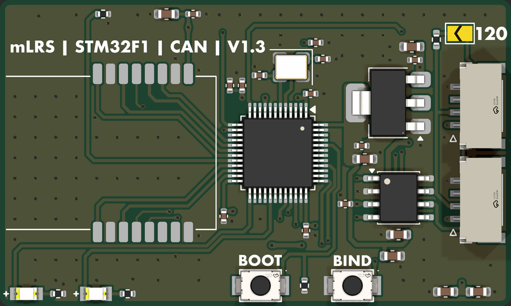
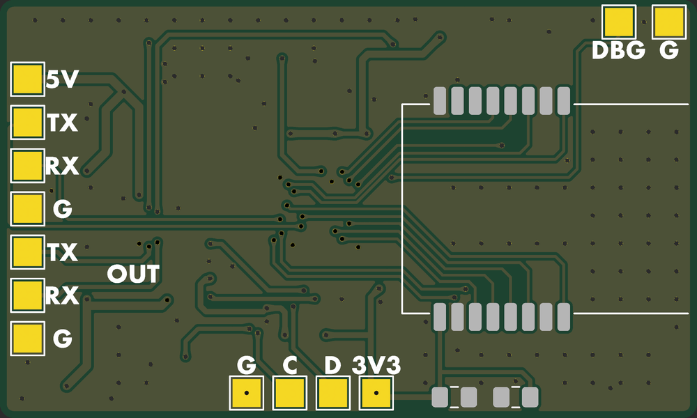

# F1-CAN-Receiver

An [mLRS](https://github.com/olliw42/mLRS) 2.4 GHz CAN receiver: STM32F103C8T6, two E28-2G4M27S (SX1281) for
diversity, and an SN65HVD230 CAN transceiver, powered from the CAN 5 V. Based on Olli's dual-E28 board02.

 

## Connectors

**J1, J2 CAN** (CJT A1257WR-S-4P, JST-GH compatible, in parallel): 1 5V, 2 CAN_H, 3 CAN_L, 4 GND. Close **JP1** to terminate.

**Test pads** (bottom): UART1 (5V, TX, RX, G; also the ROM bootloader, hold BOOT0 at power-up), UART2 OUT, SWD, DBG.

## Assembly

JLC assembles the top side. M1 (top), M2 (bottom), C18 and C19 are DNP and soldered by hand; leave M2 off for a single radio.

## Docs

[docs/design.md](docs/design.md): design decisions, pin map, BOM and firmware notes.

## License

[MIT](../LICENSE)
