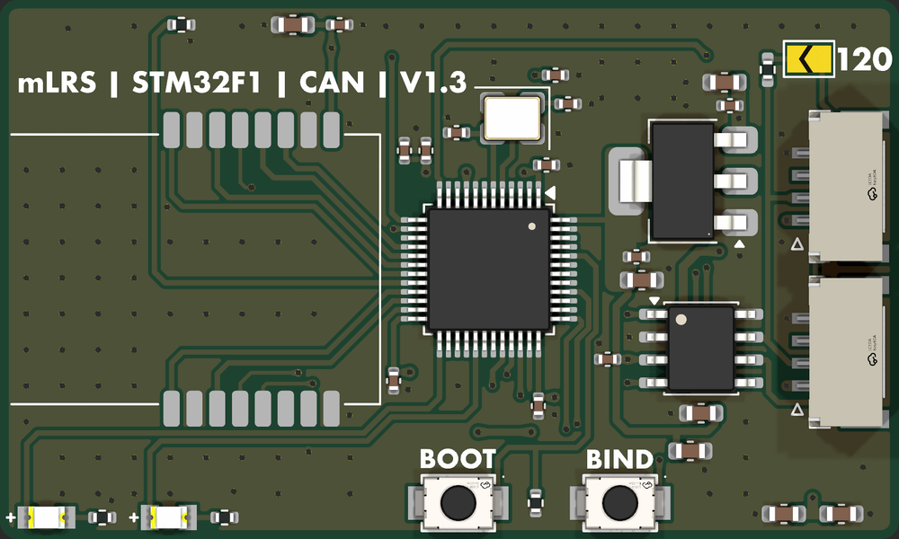
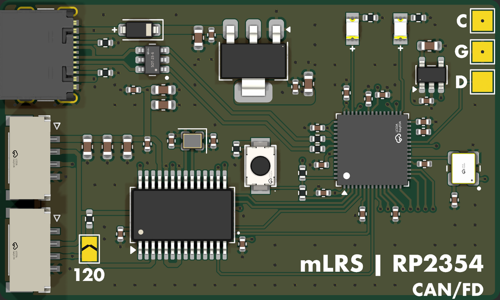

# Hardware-mLRSReceivers

[mLRS](https://github.com/olliw42/mLRS) receiver boards with CAN, designed in KiCad 10.

| Board | What it is |
|---|---|
|  [F1-CAN-Receiver](F1-CAN-Receiver) | STM32F103 + dual E28 (SX1281), 2.4 GHz CAN |
|  [RP-mLRS](RP-mLRS) | RP2354A + NiceRF LR2021, CAN or CAN FD, USB-C |

Each board folder has its KiCad project, schematic PDF, renders and JLCPCB production files.

## License

[MIT](LICENSE)
