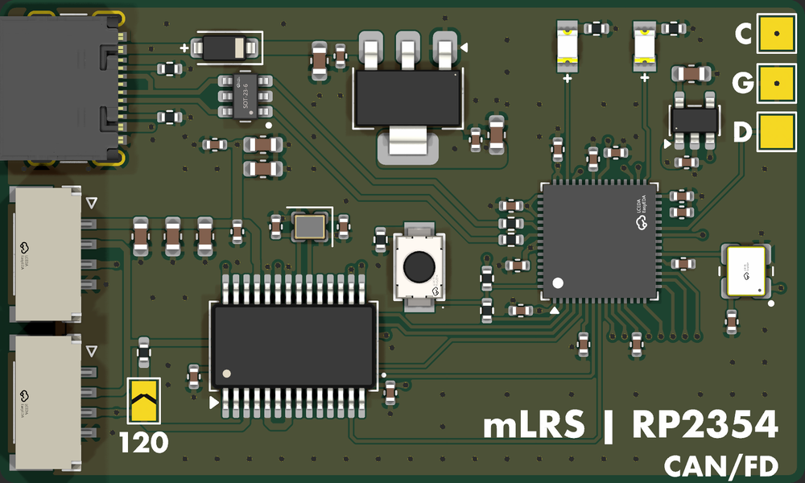
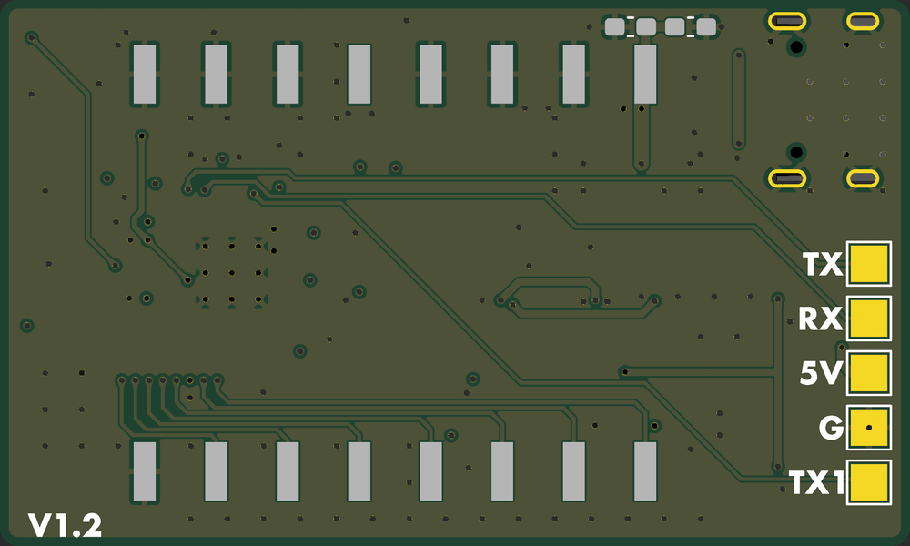

# RP-mLRS

An [mLRS](https://github.com/olliw42/mLRS) receiver: RP2354A, NiceRF LR2021 (Sub-GHz + 2.4 GHz), two GH-compatible
CAN connectors and USB-C.

 

One PCB, [`RP-mLRS-DUAL/`](RP-mLRS-DUAL), takes either CAN interface, chosen at assembly:

| Build | CAN interface | Fit | Production files |
|---|---|---|---|
| CANFD | MCP251863 controller + transceiver (SPI0) | U5 | `production-canfd/` |
| CAN | [can2040](https://github.com/KevinOConnor/can2040) (PIO) + SN65HVD230 | U7 | `production-can/` |

## Connectors

**J2, J3 CAN** (CJT A1257WR-S-4P, JST-GH compatible, in parallel): 1 +5V, 2 CANH, 3 CANL, 4 GND.
Bridge **JP1** for 120 Ω termination at a bus end.

**J1 USB-C**: power (through a Schottky) and firmware.

**Test pads**: top C / G / D = SWCLK / GND / SWDIO; bottom TX / RX = UART1, TX1 = UART0 TX, 5V, G.

## Assembly

JLC assembles the top side. U4 (LR2021), C23 and C24 are on the bottom, marked DNP, and soldered by hand.

## Docs

- [docs/FIRMWARE.md](docs/FIRMWARE.md): GPIO map and firmware notes
- [docs/COST-REDUCED.md](docs/COST-REDUCED.md): CAN-build cost notes

## License

[MIT](../LICENSE)
